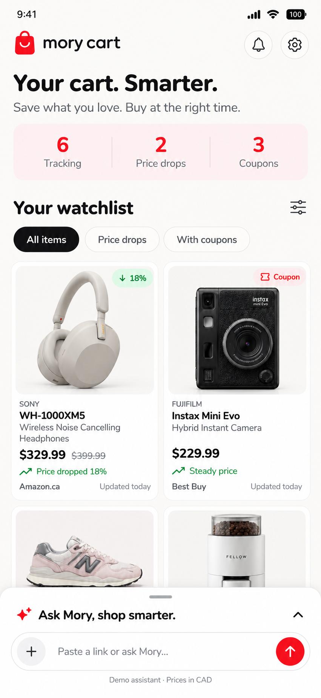

# MoryDeals UI design direction

## Scope

A shared Web / React Native UI package and runnable component showcase. The user requested theme / Mory reuse, independent character parts, animation controls, a chat dock instead of bottom navigation, and the old product card's mini chart.

## Reference provenance

Reference: ../morydeals-affiliate, main snapshot edfa45c1930a03315c9e5dab75346f4e20b5d5b1. Files were copied using git show; the old checkout and unrelated changes remain untouched.

| Original | Reuse / adaptation |
| --- | --- |
| packages/design/tokens.json, theme tokens / typography / Mory colors | Design values preserved; generated locally |
| theme/fonts.ts | Names and loading behavior preserved; four direct weight imports |
| mory/, BrandSparkles, haptics | Silhouette, effects, clocks and entrance retained; character split into parts / props / motion |
| primitives/Pressable.tsx | Press / release timing and Reduce Motion copied; focus tracking added |
| commerce/PriceSpark.tsx | Copied directly; consumed beside the merchant |
| commerce/ProductTile.tsx | Card hierarchy, price color and merchant / sparkline row referenced |
| layout/PhaseFade.tsx | Copied into shared motion; used for coupon feedback |
| AssistantDock, DockInput, DockMory | Interaction and character context references; new shared dock contains chat and composer |

## Feedback refinements

Body, expression, fruit, hands and held objects share a 200-grid and animate in independent layers. Orange, apple, pear and none are available. Original orange artwork and body proportions remain.

- tag: straight edges, uniform scaling, original Nunito dollar as filled artwork; no rotation.
- deals: stacked discount coupons with a percent mark and gentle vertical movement.
- peek: clipped body and gripping hands; the consumer supplies the real surface, with no artificial board.
- hands: holding, waving and tapping combine with an independently chosen object.
- motion: body, eyes, fruit, prop, effects and entrance are separately controlled; typing can follow input.

Actions use the old motion timing with a new compact flat border, icon inset, hover / focus feedback and neutral disabled surface. Selected chips use a red dot and soft red surface.

The final UI uses flat fills and thin boundaries. Buttons use pill outlines and circular icon buttons. Controls have no raised bottom edge or elevation shadow; the chat dock has no drop shadow, and charts use a uniform light fill rather than a gradient.

Cards keep the old merchant / mini-chart row. Sparklines use steps, a final dot and low / drop / steady colors. Unavailable history gets no sparkline. Prices, status and coupon facts stay controlled presentation data.

## Showcase states

Products: drop, coupon, steady, metadata pending. History: 30 days, flat 7 days, one observation, none, target. Coupons: idle, copying, copied, error. Chat: welcome, conversation, long thread, expand / collapse, keyboard, sending, rejected draft. Sheets: input, callback and dismissal.

The conceptual image records the early chat direction; the runnable showcase is the current review surface.

## Validation boundaries

Tokens, TypeScript and Mory composition / timing are local checks. The gallery is exercised in the in-app browser at desktop and phone widths, and in Expo Go on the iPhone 17 Pro / iOS 26.5 simulator. Physical devices and Android interaction are unvalidated in this session. Sample histories, codes and replies do not establish backend behavior.

## Reference correction: cards and dock

The new ProductTile / ProductRow follow the original card hierarchy; the third small vertical shape shares that hierarchy with reduced media and type size. The previous added percentage/status/subtitle rows were removed. Card actions are independent siblings. PurchaseButton is adapted directly from the old implementation with formatted price props and flat outlined buttons. Its copied phase lasts 350 ms before Buy now; failures expose selectable code and still permit purchase.

Masonry uses the old shopper image-height hash/table and a shared native/web shortest-column layout. It is a presentation wall, not a virtualized application feed.

The old `apps/mobile/src/shell/dock/{AssistantDock,useDockSnap,DockInput,DockMory}` establish fixed handle/input measurement, folded/half/full positions, a 220 ms settle, 0.15-second fling projection, 48 px top merge, a separate fading function line, 200 ms leading-action fade and 3-second Mory reaction. The shared package adapts those behaviors. PanResponder provides the native gesture adapter; a separate web adapter tracks pointer movement on the window so a moving handle does not lose the gesture; the showcase supplies a bounded canvas and optional keyboard geometry. App navigation and assistant services are replaced with presentation callbacks.

All branding and workspace names use MoryDeals (`@morydeals/ui`, `@morydeals/ui-showcase`). The checkout folder retains its existing path.
